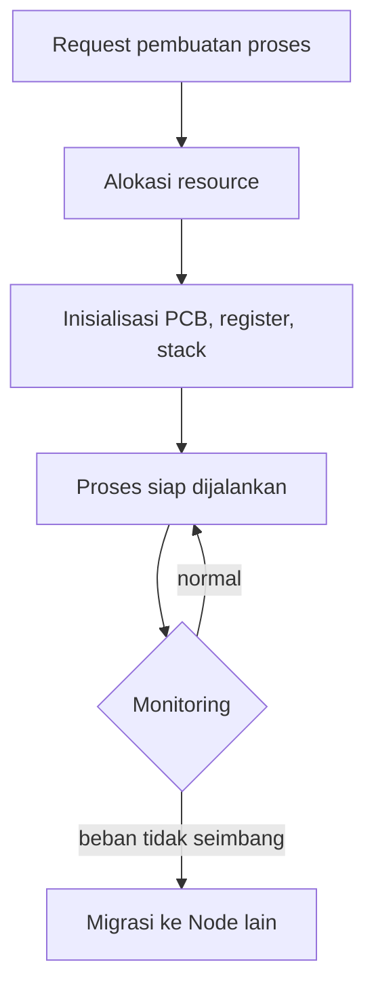
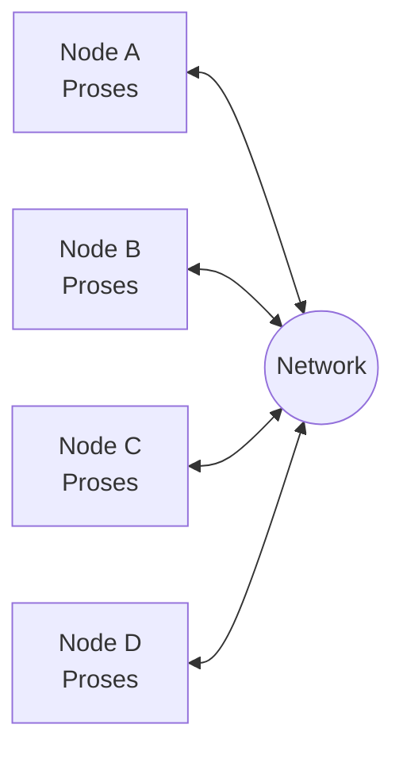
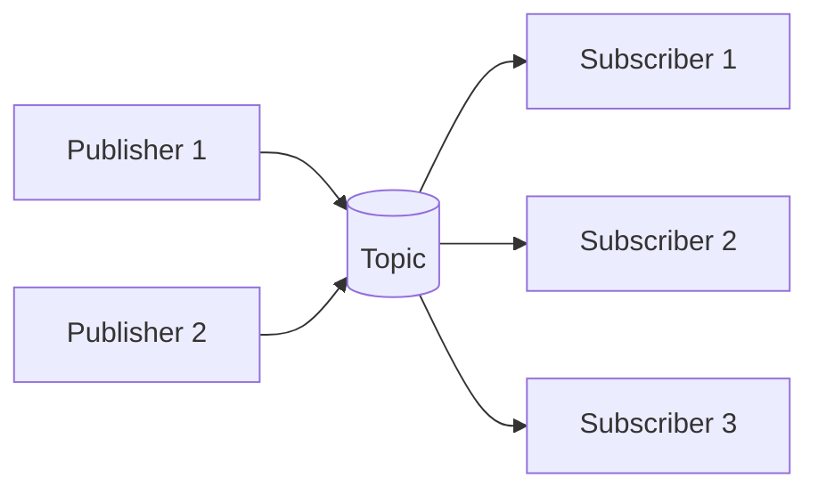
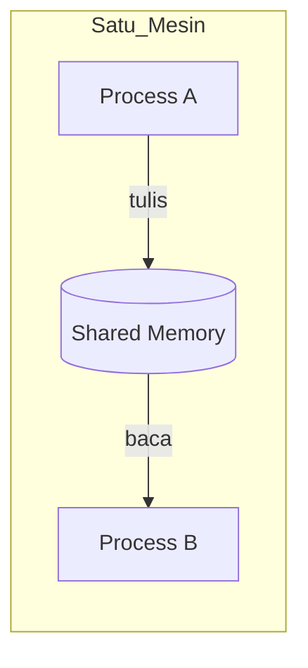
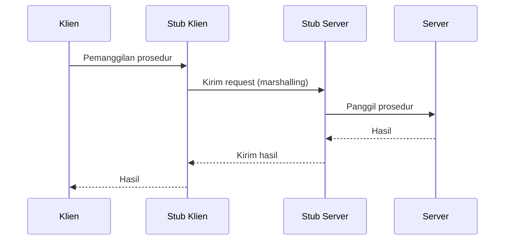
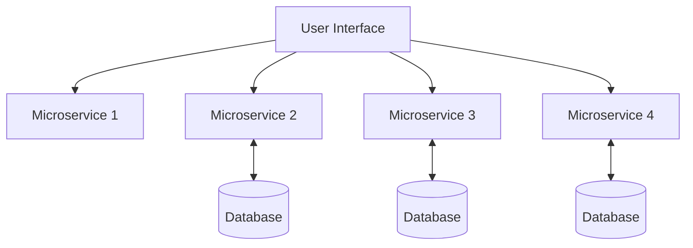
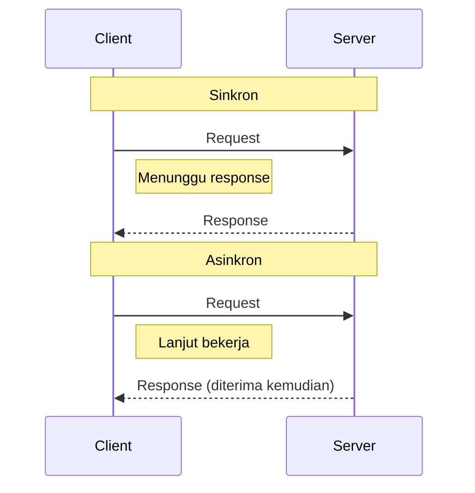

# Modul 2 — Proses dan Komunikasi Antar Proses pada Sistem Terdistribusi

- **Program Studi**: Informatika
- **Kode MK**: FIF25002T
- **SKS**: 3
- **Pengampu**: Dr. Bambang Purnomosidi D. P.
- **Fakultas**: Teknologi Informasi, UTDI

---

## Tujuan Pembelajaran

Setelah mempelajari modul ini, mahasiswa mampu:

1. Menjelaskan konsep **proses** pada sistem terdistribusi.
2. Menjelaskan berbagai jenis **komunikasi antar proses (IPC)**.
3. Menganalisis isu **sinkronisasi, reliabilitas, dan keamanan** pada sistem terdistribusi.
4. Mengaitkan konsep ke contoh nyata seperti **microservices, cloud, dan distributed messaging**.

## Daftar Isi

1. [Apa Itu Proses?](#1-apa-itu-proses)
2. [Manajemen Proses](#2-manajemen-proses)
3. [Sistem Terdistribusi dan Komunikasi](#3-sistem-terdistribusi-dan-komunikasi)
4. [Model Komunikasi Pesan](#4-model-komunikasi-pesan)
5. [Proses pada Sistem Terdistribusi](#5-proses-pada-sistem-terdistribusi)
6. [IPC (Inter-Process Communication)](#6-ipc-inter-process-communication)
7. [Message Passing](#7-message-passing)
8. [RPC (Remote Procedure Call)](#8-rpc-remote-procedure-call)
9. [MOM (Message-Oriented Middleware)](#9-mom-message-oriented-middleware)
10. [Studi Kasus: Microservices](#10-studi-kasus-microservices)
11. [Komunikasi Sinkron dan Asinkron](#11-komunikasi-sinkron-dan-asinkron)
12. [Berbagai Masalah pada Komunikasi Antar Proses](#12-berbagai-masalah-pada-komunikasi-antar-proses)
13. [Protokol Komunikasi](#13-protokol-komunikasi)
14. [Konsep Sinkronisasi](#14-konsep-sinkronisasi)
15. [Logical Clock](#15-logical-clock)
16. [Koordinasi Proses](#16-koordinasi-proses)
17. [Tantangan dan Solusi](#17-tantangan-dan-solusi-terkait-proses-pada-sistem-terdistribusi)
18. [Current Issues](#18-current-issues)
19. [Diskusi](#19-diskusi)
20. [Rangkuman](#rangkuman)
21. [Referensi](#referensi)

---

## 1. Apa Itu Proses?

**Program** adalah kumpulan instruksi yang tersimpan di disk. Ketika program dijalankan, sistem operasi membuat **proses**, yaitu *instance* program yang sedang dieksekusi dan dimuat ke RAM.

- Satu proses dapat memiliki satu atau lebih **thread**.
- **Scheduler** (bagian dari OS) memilih thread yang akan dieksekusi oleh CPU berdasarkan prioritas, melalui mekanisme **context switch** dan **preemption**.


Contoh nyata proses dapat dilihat dengan perintah `htop` atau `ps` di Linux. Setiap proses memiliki **PID**, pemilik (*user*), konsumsi CPU dan memori, serta status (misalnya `R` = running, `S` = sleeping).

```bash
htop
ps aux
```

> Sumber gambar konsep: <https://en.wikipedia.org/wiki/Process_(computing)>

## 2. Manajemen Proses

Sistem operasi mengelola proses melalui tiga aktivitas utama:

- **Process creation**: OS membuat proses baru, mengalokasikan sumber daya (memori, file, dsb.), lalu menginisialisasi lingkungan eksekusinya (PCB, register, stack) sampai proses *ready to run*.
- **Process migration**: OS memindahkan proses yang berjalan/siap dari satu CPU (atau node) ke yang lain untuk menyeimbangkan beban, meningkatkan performa, atau menangani kegagalan. Status proses, *resource binding*, dan lokasi harus diperbarui.
- **Process monitoring**: OS melacak status proses, penggunaan sumber daya, dan performa, lalu mengambil tindakan korektif jika diperlukan.



## 3. Sistem Terdistribusi dan Komunikasi

**Sistem terdistribusi** adalah sekumpulan komputer/*node* yang independen dan bekerja bersama dalam satu koordinasi sebagai **satu kesatuan logis**.

- Setiap node menjalankan proses.
- Agar dapat bekerja sebagai satu sistem logis, antar node **harus berkomunikasi**.
- Karena itu diperlukan **komunikasi antar proses pada berbagai node**.



**Jenis komunikasi antar node:**

- **Request**: Permintaan layanan/data
- **Response**: Hasil/balasan
- **Publish**: Mengirim event/update
- **Subscribe**: Menerima notifikasi

**Fungsi komunikasi antar node:** pertukaran data, koordinasi (sinkronisasi, konsistensi data, manajemen transaksi), keandalan (sistem tetap berjalan meski satu node gagal), dan skalabilitas (node dapat ditambah/dikurangi dinamis).

**Contoh nyata:**

1. *Multiplayer games.*
2. **Gojek/Grab**: antarmuka pengguna berkomunikasi dengan layanan untuk (1) driver, (2) pelacakan lokasi, (3) penghitungan biaya, dst.
3. **Chat/Video call WhatsApp**: komunikasi *point-to-point* pada infrastruktur terdistribusi.

## 4. Model Komunikasi Pesan

### 4.1 Langsung (menggunakan socket)

**Server** (echo server):

```python
import socket

HOST = '127.0.0.1'  # Standard loopback interface address (localhost)
PORT = 65432        # Port to listen on (non-privileged ports are > 1023)

with socket.socket(socket.AF_INET, socket.SOCK_STREAM) as s:
    s.bind((HOST, PORT))
    s.listen()
    conn, addr = s.accept()
    with conn:
        print(f"Connected by {addr}")
        while True:
            data = conn.recv(1024)
            if not data:
                break
            print(f"Received: {data.decode()}")
            conn.sendall(data)  # Echo back the received data
```

**Client:**

```python
import socket

HOST = '127.0.0.1'  # The server's hostname or IP address
PORT = 65432        # The port used by the server

with socket.socket(socket.AF_INET, socket.SOCK_STREAM) as s:
    s.connect((HOST, PORT))
    s.sendall(b"Hello, world!")
    data = s.recv(1024)

print(f"Received from server: {data.decode()}")
```

Cara menjalankan: buka dua terminal, jalankan `python server.py` di terminal pertama, lalu `python client.py` di terminal kedua.

### 4.2 Tidak Langsung

Menggunakan **mailbox / message queue** (misalnya perintah `write` di Linux). Pengirim dan penerima tidak harus berinteraksi secara langsung pada saat yang sama.

### 4.3 Publish/Subscribe (Pub/Sub)

Publisher mengirim pesan ke sebuah **topic**, lalu topic meneruskannya ke semua **subscriber**.



> Sumber: <https://dashbird.io/knowledge-base/well-architected/pub-sub-messaging/>

## 5. Proses pada Sistem Terdistribusi

- Proses pada sistem terdistribusi bisa berada pada **node yang berbeda**.
- **Tidak ada shared memory** karena proses berada pada node yang berbeda.
- Oleh karena itu, **IPC khusus untuk sistem terdistribusi** diperlukan.

## 6. IPC (Inter-Process Communication)

Pada dasarnya ada 4 jenis IPC:

1. **Shared Memory**
2. **Message Passing**
3. **Remote Procedure Call (RPC)**
4. **Middleware**

> **Catatan:** *Shared memory* tidak cocok untuk sistem terdistribusi karena tidak ada akses terhadap memori pada berbagai node. Proses A menulis ke area memori bersama dan Proses B membaca dari area yang sama, sehingga hanya bekerja pada satu mesin.



> Sumber: <https://medium.com/@haasitapinnepu/the-art-of-conversation-in-distributed-systems-interprocess-communication-a651d97e12e1>

## 7. Message Passing

Proses saling bertukar pesan melalui *communication link* dengan operasi dasar:

```text
send(Q, message)      # Process P mengirim pesan ke Q
receive(P, message)   # Process Q menerima pesan dari P
```

- **Standar:** MPI (*Message Passing Interface*), <https://www.mpi-forum.org/>
- **Versi terakhir (sampai Oktober 2026):** 5.0, lihat <https://www.mpi-forum.org/implementation-status/>
- **Implementasi:** misalnya Open MPI; untuk Python tersedia [`mpi4py`](https://mpi4py.readthedocs.io/en/stable/).

Contoh `mpi4py` (proses 0 mengirim ke proses 3), simpan sebagai `mpi_demo.py`:

```python
from mpi4py import MPI

comm = MPI.COMM_WORLD
rank = comm.Get_rank()

if rank == 0:
    comm.send({"pesan": "Halo dari proses 0"}, dest=3, tag=11)
elif rank == 3:
    data = comm.recv(source=0, tag=11)
    print(f"Proses 3 menerima: {data}")
```

```bash
mpirun -n 4 python mpi_demo.py
```

## 8. RPC (Remote Procedure Call)

RPC membuat pemanggilan prosedur di komputer lain terasa seperti pemanggilan fungsi lokal. **Stub** di sisi klien dan server menangani *marshalling* (pengemasan) parameter dan hasil serta pengiriman melalui jaringan.



**Contoh: gRPC.** Klien dalam bahasa berbeda (misalnya Ruby dan Android-Java) memanggil layanan berbasis C++ melalui *gRPC stub*. Pesan didefinisikan dengan **Protocol Buffers** (*Proto Request* / *Proto Response*).

Contoh definisi layanan (`.proto`):

```proto
syntax = "proto3";

service Salam {
  rpc Sapa (SapaRequest) returns (SapaReply);
}

message SapaRequest { string nama = 1; }
message SapaReply   { string pesan = 1; }
```

> Referensi: <https://grpc.io/docs/what-is-grpc/introduction/>

## 9. MOM (Message-Oriented Middleware)

- Infrastruktur yang memfasilitasi komunikasi dan pertukaran data melalui pesan.
- Memungkinkan transfer data antar aplikasi melalui saluran komunikasi yang membawa unit informasi mandiri yang disebut **message**.
- Dalam lingkungan berbasis MOM, pesan dikirim dan diterima secara **asinkron**.


**Standar dan protokol MOM:**

- **1. X/Open XATMI**: *Distributed Transaction Processing: The XATMI Specification*
- **2. AMQP (*Advanced Message Queuing Protocol*)**: Biasanya untuk *enterprise apps*
- **3. HLA IEEE 1516 (*High Level Architecture*)**: Dari IEEE dan SISO (*Simulation Interoperability Standards Organization*)
- **4. MQTT (*MQ Telemetry Transport*)**: Biasanya untuk *resource constrained devices*
- **5. DDS (*Data Distribution Service*)**: Dari OMG (*Object Management Group*)
- **6. XMPP (*eXtensible Messaging and Presence Protocol*)**: Pesan dan presence

Contoh implementasi populer: **RabbitMQ** (AMQP) dan **Kafka** (message queue/streaming).

## 10. Studi Kasus: Microservices

Pada arsitektur **microservices**, aplikasi dipecah menjadi layanan-layanan kecil yang independen. Setiap layanan umumnya memiliki **database sendiri** dan dipanggil oleh *user interface* (atau antar layanan) melalui jaringan. Seluruh interaksi tersebut adalah komunikasi antar proses pada node yang berbeda, sehingga semua isu pada modul ini (sinkron/asinkron, reliabilitas, urutan, keamanan, sinkronisasi waktu) muncul secara nyata.



> Sumber: <https://www.akamai.com/glossary/what-are-microservices>

## 11. Komunikasi Sinkron dan Asinkron

- **Alur**
  - Sinkron: Klien mengirim request lalu **menunggu** response
  - Asinkron: Klien mengirim request lalu **melanjutkan pekerjaan**, response diterima kemudian
- **Kopling**
  - Sinkron: Ketat (klien bergantung pada server saat itu juga)
  - Asinkron: Longgar
- **Contoh**
  - Sinkron: HTTP request-response, RPC klasik
  - Asinkron: Message queue, pub/sub, MOM



## 12. Berbagai Masalah pada Komunikasi Antar Proses

- **Reliability**
  - Penjelasan: Memastikan pesan terkirim lengkap dan dalam urutan yang benar, bahkan saat ada kehilangan paket atau sistem *crash*.
  - Solusi: (1) *Acknowledgement*, (2) mekanisme transmisi ulang, (3) protokol transport andal seperti **TCP** (pengiriman terjamin dan teratur).
- **Ordering**
  - Penjelasan: Memastikan pesan diproses dalam urutan yang dapat diprediksi dan logis.
  - Solusi: (1) Pipes (FIFO), (2) Message queues, (3) Shared memory, (4) Sockets dan message passing, (5) RPC.
- **Security**
  - Penjelasan: Melindungi kerahasiaan dan keaslian komunikasi.
  - Solusi: Enkripsi, autentikasi.
- **Performance**
  - Penjelasan: Kecepatan komunikasi.
  - Solusi: Perhatikan **latency** dan **bandwidth**.

## 13. Protokol Komunikasi

**Protokol yang mendasari:**

- TCP
- UDP
- HTTP

**Protokol utama yang berjalan di atas HTTP sebagai transport protocol:**

- gRPC
- GraphQL
- REST

**HTTP/2 vs HTTP/3:**

- **Application**
  - HTTP/2: HTTPS
  - HTTP/3: HTTPS
- **Security**
  - HTTP/2: TLS
  - HTTP/3: QUIC (menyertakan keamanan)
- **Transport**
  - HTTP/2: TCP
  - HTTP/3: QUIC di atas UDP
- **Network**
  - HTTP/2: IP
  - HTTP/3: IP

> Sumber: <https://www.stackscale.com/blog/http3/>

## 14. Konsep Sinkronisasi

- Sistem terdistribusi terdiri atas lebih dari satu node, dan **setiap node punya clock/jam lokal sendiri**.
- **Sinkronisasi clock** adalah proses menyelaraskan clock lokal beberapa komputer melalui jaringan ke waktu yang sama dan konsisten.
- Krusial untuk **pengurutan kejadian yang akurat, konsistensi data, dan operasi yang terkoordinasi**.
- Karena latensi jaringan dan *clock drift* perangkat keras, clock lokal secara alami menyimpang (deviasi).

**Metode umum:**

1. **Sinkronisasi eksternal** menggunakan *atomic clock*, yang menghasilkan **TAI** (*International Atomic Time*), bersama **GPS** dan **UTC** (*Universal Coordinated Time*) jika diperlukan.
2. Sinkronisasi menggunakan protokol seperti **NTP** (*Network Time Protocol*) atau **PTP** (*Precision Time Protocol*).

> **Catatan:** PTP lebih presisi daripada NTP.

## 15. Logical Clock

### Masalah dengan real clock timestamp

Contoh 3 layanan: **Sales Service** → **Product Service** → **Invoice Service**, yang semuanya mengirim log ke **Central Logging Service**.

Urutan waktu sesungguhnya:

- **12:00:01**: Transaksi penjualan terjadi, dicatat pada Sales Service.
- **12:00:02**: Product Service menerima informasi transaksi, memperbarui jumlah produk terjual.
- **12:00:03**: Invoice Service menghasilkan faktur/invoice.

Jika pencatatan memakai *real clock timestamp*, ada kemungkinan **pergeseran event** akibat latensi, masalah jaringan, masalah hardware, dll., sehingga urutan di log bisa salah.

### Lamport Logical Clock

Menggunakan *logical clock* yang tidak terkait langsung dengan real clock:

1. Setiap ada kejadian, angka logical clock **bertambah satu**.
2. Saat mengirim pesan, komputer **menyertakan** angka logical clock.
3. Saat menerima pesan, komputer membandingkan angka pada pesan dengan logical clock miliknya, **ambil angka terbesar, lalu tambahkan 1**.

**Kasus logging** (semua service mulai dari logical clock = 0):

- **1. Sales**
  - Aksi: Mencatat transaksi, clock +1, kirim request ke Product dengan timestamp **1**
  - Clock setelah aksi: 1
- **2. Product**
  - Aksi: Terima timestamp 1; bandingkan dengan lokal (0), ambil terbesar (1), update menjadi **2**, kirim ke Invoice dengan timestamp **2**
  - Clock setelah aksi: 2
- **3. Invoice**
  - Aksi: Terima timestamp 2; bandingkan dengan lokal (0), ambil terbesar (2), update menjadi **3**, hasilkan faktur
  - Clock setelah aksi: 3

Hasil: urutan event benar, yaitu **1 – Sales, 2 – Product, 3 – Invoice**.

Aturan umum: `L = max(L_lokal, L_pesan) + 1` saat menerima pesan.

**Simulasi sederhana dengan Python** (mengikuti contoh pada slide):

```python
class LamportClock:
    def __init__(self, nama):
        self.nama = nama
        self.time = 0

    def event(self):
        """Kejadian lokal: clock +1."""
        self.time += 1
        return self.time

    def receive(self, ts_pesan):
        """Terima pesan: ambil terbesar, lalu +1."""
        self.time = max(self.time, ts_pesan) + 1
        return self.time

sales, product, invoice = LamportClock("Sales"), LamportClock("Product"), LamportClock("Invoice")

# 1. Sales mencatat transaksi, lalu kirim ke Product membawa timestamp
ts = sales.event()
print(f"Sales  : clock={sales.time}, kirim ke Product (ts={ts})")

# 2. Product terima, update clock, lalu kirim ke Invoice membawa clock-nya
product.receive(ts)
print(f"Product: clock={product.time}, kirim ke Invoice (ts={product.time})")

# 3. Invoice terima, update clock, lalu hasilkan faktur
invoice.receive(product.time)
print(f"Invoice: clock={invoice.time}, faktur dibuat")
```

Keluaran: Sales = 1, Product = 2, Invoice = 3, sehingga urutan kausalnya benar.

### Pengembangan dari Lamport

Lamport clock masih berupa **scalar clock**. Perbaikan dan variannya:

- **1. Vector clocks**: Colin Fidge dan Friedemann Mattern (1988)
- **2. Plausible clocks**: Torres-Rojas dan Ahamad (1999)
- **3. Chain clocks**: Agarwal dan Garg (2005)
- **4. Interval tree clocks**: Almeida dkk. (2008)
- **5. Blum clocks**: Lum Ramabaja (2019)

> Sumber: <https://medium.com/outreach-prague/lamport-clocks-determining-the-order-of-events-in-distributed-systems-41a9a8489177>

## 16. Koordinasi Proses

**Koordinasi proses** adalah mekanisme yang memungkinkan beberapa proses independen di berbagai komputer bekerja sama secara harmonis, memastikan tujuan bersama tercapai dengan mengelola **komunikasi, sinkronisasi, dan akses ke sumber daya bersama** tanpa konflik seperti **deadlock** atau **race condition**.

**Contoh:** Apache ZooKeeper, etcd, Consul, ClickHouse Keeper, Oxia, KRaft.

## 17. Tantangan dan Solusi Terkait Proses pada Sistem Terdistribusi

- **Message loss**: *Retransmission* dan *acknowledgement*
- **Deadlock**: *Timeout*, *detection algorithm*
- **Data inconsistency**: *Consensus protocol* (Raft, Paxos)
- **Security**: SSL/TLS, OAuth2

## 18. Current Issues

- **Edge and Fog Computing**
- **Observability and tracing:** telemetry
- **Container orchestration:** Kubernetes, Docker Swarm

## 19. Diskusi

1. Apakah **GraphQL** merupakan contoh dari RPC?
2. Apakah **REST** merupakan contoh dari RPC?
3. Apakah **Telemetry** merupakan solusi etis?

**Petunjuk berpikir (bukan jawaban tunggal):**

- *GraphQL dan REST vs RPC:* bandingkan **model abstraksi**. RPC berfokus pada *memanggil prosedur/aksi* (`hitungBiaya(...)`), REST berfokus pada *sumber daya* dan operasi standar HTTP (`GET /pesanan/12`), sedangkan GraphQL berfokus pada *query data* dengan skema yang dipilih klien. Diskusikan juga apakah di sisi implementasi keduanya tetap berupa pola request-response jarak jauh (sehingga mirip RPC), dan di mana batasnya menjadi kabur.
- *Telemetry:* timbang manfaat (observability, deteksi masalah, perbaikan layanan) terhadap risiko (privasi, persetujuan pengguna/*consent*, minimisasi data, penyalahgunaan data, transparansi). Pertimbangkan data apa yang dikumpulkan dan siapa yang mengaksesnya.

## Rangkuman

- Proses adalah program yang sedang dieksekusi; pada sistem terdistribusi, proses tersebar di banyak node **tanpa shared memory**.
- IPC untuk sistem terdistribusi memakai **message passing, RPC, dan middleware (MOM)**.
- Komunikasi dapat **sinkron** atau **asinkron**, **langsung** (socket), **tidak langsung** (message queue), atau **pub/sub**.
- Masalah utama: **reliability, ordering, security, performance**.
- Setiap node punya clock sendiri, sehingga dibutuhkan **sinkronisasi clock** (NTP/PTP) atau **logical clock** (Lamport, vector clock) untuk mengurutkan event.
- **Koordinasi proses** (ZooKeeper, etcd, Consul, dll.) dan **consensus protocol** (Raft, Paxos) menjaga konsistensi dan mencegah konflik.

## Referensi

- Process (computing): <https://en.wikipedia.org/wiki/Process_(computing)>
- Pub/Sub messaging: <https://dashbird.io/knowledge-base/well-architected/pub-sub-messaging/>
- The Art of Conversation in Distributed Systems (IPC): <https://medium.com/@haasitapinnepu/the-art-of-conversation-in-distributed-systems-interprocess-communication-a651d97e12e1>
- MPI Forum: <https://www.mpi-forum.org/> dan <https://www.mpi-forum.org/implementation-status/>
- mpi4py: <https://mpi4py.readthedocs.io/en/stable/>
- gRPC: <https://grpc.io/docs/what-is-grpc/introduction/>
- Microservices (Akamai): <https://www.akamai.com/glossary/what-are-microservices>
- HTTP/3 (Stackscale): <https://www.stackscale.com/blog/http3/>
- Lamport Clocks: <https://medium.com/outreach-prague/lamport-clocks-determining-the-order-of-events-in-distributed-systems-41a9a8489177>
